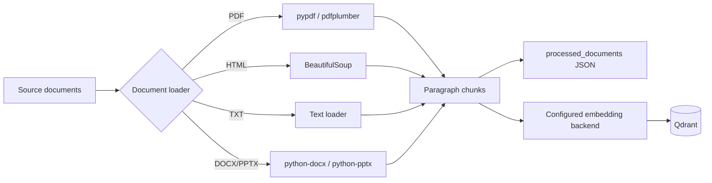

# Document ingestion

The ingestion pipeline extracts document text, saves chunks in `processed_documents/`, and indexes their embeddings in Qdrant. This is the optional cloud pipeline. The default local app searches the saved document text and does not require an ingestion run or provider credentials.

## Pipeline



## Text extraction

Parsing runs locally; the loaders do not call an OCR service.

- **PDF**: `pypdf` extracts text first. Pages with no extracted text are retried with `pdfplumber`. Image-only pages may still produce no text.
- **HTML**: BeautifulSoup removes script and style content before extracting text.
- **Office documents**: `python-docx` and `python-pptx` handle `.docx` and `.pptx` files.
- **Plain text**: A text loader reads `.txt` files.

## Chunking and storage

The splitter packs paragraphs into chunks of up to `1500` characters. A paragraph that exceeds the limit is split into smaller pieces. There is no explicit chunk overlap, and a long paragraph can be split within a sentence.

`RAG_EMBEDDING_BACKEND=gemini` uses `gemini-embedding-2-preview` with `3072` dimensions. Explicit `local` selection uses all-mpnet-base-v2 with `768` dimensions. Ingestion and retrieval must use the same backend and a compatible collection. Qdrant stores these vectors with cosine distance (`models.Distance.COSINE`). Provider failures stop the operation rather than switching models.

Re-ingesting a filename and source type replaces its chunks. Obsolete chunks are removed after the replacement vectors have been accepted.

## Run ingestion

Install the cloud dependencies and configure the provider environment first. Subdirectories containing `true` or `noisy` map to those source types; other subdirectory names are used as source types directly.

```bash
python -m rag.ingestion.document_processor data
```

Pass `--wipe` only to delete and recreate the selected Qdrant collection. The source directory and embedding provider are checked before deletion. Restart the local app after updating its saved document text.
