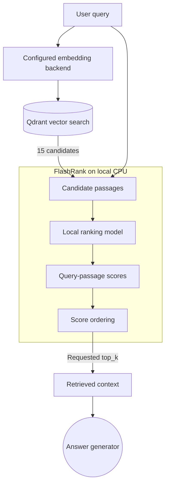

# Document reranking

The optional cloud retriever uses FlashRank to reorder Qdrant candidates before answer generation. FlashRank runs locally. The default local runtime uses BM25 retrieval and does not load FlashRank.

## Retrieval and reranking

Qdrant compares the query embedding with stored document embeddings using cosine similarity. That search produces a candidate list without running a model over every query-document pair.

FlashRank then scores each candidate together with the query. This second pass can change the order when the initial vector similarity does not capture the question's wording well. It adds model execution time, so the retriever applies it to a small candidate list.

The retriever requests 15 candidates and retains the requested `top_k` results. The API defaults to 4 results and allows up to 8. Reference scope filters Qdrant points with `source_type=true`; full scope searches the collection without that filter.

## Model loading

`rag/services/retrieval/reranker.py` creates a FlashRank `Ranker` on first use. It first tries the cache directory `/tmp/flashrank`, then retries with FlashRank's default cache configuration if initialization fails.

The code does not pass a model name to `Ranker`, so the installed FlashRank version determines its default model. The first query may download model files. Later calls reuse the process's loaded ranker. Model size and latency depend on that model, the passage lengths, and the machine running it; the project does not enforce a latency target.

## Failure behavior

`rerank_documents(query, documents, top_n)` returns an empty list when there are no candidates. It otherwise passes dictionaries containing passage IDs and text to `RerankRequest`, then returns the highest-ranked text passages.

If initialization or ranking raises an exception, the function logs the failure and returns the first `top_n` passages in their original Qdrant order. This fallback preserves retrieved context when reranking fails. It does not recover failed embeddings, Qdrant requests, or answer-generation calls, and it does not guarantee an answer is correct.

## Implementation

The project calls FlashRank directly rather than using a LangChain document compressor. The helper accepts `list[str]`, which matches the retriever's text-based graph state, and contains its own logging and fallback logic.

Successful calls log elapsed ranking time and the leading score. These values describe that call, rather than serving as a quality guarantee or a benchmark. Reranking itself uses the local model; embedding, vector search, and answer generation still use the configured services.
