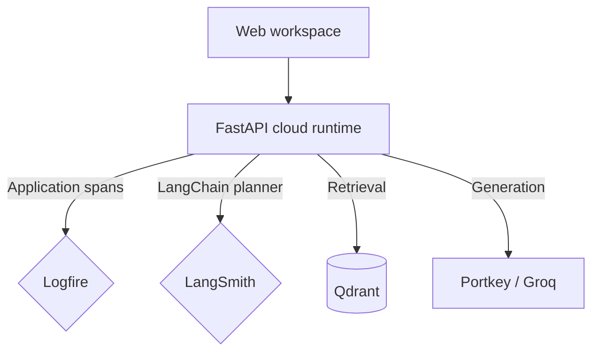

# Observability

The optional cloud pipeline uses Logfire logging and spans, with LangSmith tracing for its LangChain calls. These records help inspect retrieval, provider errors, and model requests. Local mode runs without either service.

## Logfire

Logfire calls surround document parsing, embedding, vector search, reranking, and cloud generation. The reranker logs elapsed time and its leading score; ingestion logs the processed filename and chunk count.

`RAGRuntime.cloud_components()` configures Logfire before importing the cloud workflow. With `LOGFIRE_TOKEN`, it uses the configured account. Without a token, the runtime calls `logfire.configure(send_to_logfire=False)`. Ingestion is a separate entry point with its own Logfire configuration.

## LangSmith

`rag/settings.py` sets LangChain tracing environment variables from the `LANGSMITH_*` configuration. LangSmith can record the LangChain planner call, including its prompt and response, when tracing is enabled and credentials are configured.

The responder calls Portkey directly, so it does not follow the same LangChain tracing path. Application plan entries record workflow events; they do not expose a model's hidden chain of thought. Correlation between separate tracing services should be checked in the actual trace records rather than assumed from the browser session ID.

Access the configured dashboards through [Logfire](https://logfire.pydantic.dev/) and [LangSmith](https://smith.langchain.com/).
