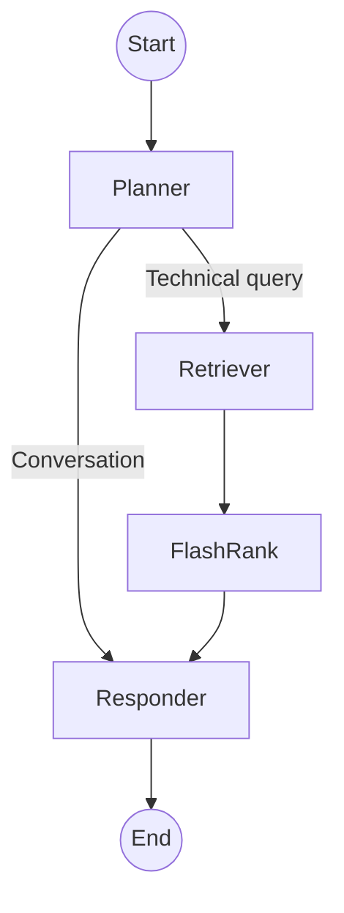

# Cloud workflow nodes

The optional cloud runtime uses LangGraph to connect a planner, retriever, and responder. The planner selects whether to retrieve documents before responding. The default local runtime uses a separate BM25 engine and returns source excerpts without running this graph.

## Planner

The planner receives the conversation history and latest user message through the configured Portkey/Groq gateway. The primary model configuration uses Llama 3.3 70B.

It returns either `CONVERSATIONAL` or a technical search query. Greetings and questions about the existing conversation can go directly to the responder. Questions about Kubernetes, Intel hardware, or networking are routed to retrieval. This is a model classification decision, so it can be wrong.

## Retriever

The retriever uses Qdrant vector search followed by local FlashRank reranking.

1. Embed the query with the selected backend. Gemini's `gemini-embedding-2-preview` produces 3072-dimensional vectors; explicit local all-mpnet-base-v2 embeddings use 768 dimensions.
2. Request 15 Qdrant candidates. Reference scope requires `source_type=true`; full scope searches all source types in the collection.
3. Score the candidate text with FlashRank and retain the requested `top_k`. The API defaults to 4 and caps the value at 8.
4. Pass those text passages to the responder.

FlashRank scores query-passage pairs on the local CPU. The code uses its default `Ranker` model and loads it on first use. If reranking fails, the retriever keeps the original Qdrant order. Embedding and Qdrant errors still fail the request.

## Responder

The responder uses the retrieved passages and conversation history to build a prompt for the configured Portkey/Groq model. Conversational requests use the history directly.

Technical requests require nonempty retrieved evidence. If retrieval returns no usable passages, or the context budget excludes all passages, the responder returns a no-evidence response without calling the generation model. The generation context budget is 25,000 characters.

The response includes retrieved text as sources. Cloud retrieval currently passes strings through the graph rather than preserving the structured document citations available in the local runtime.

## Routing

## State and memory

`MemorySaver` keeps graph checkpoints in the running process, grouped by `thread_id`. Cloud conversation history is lost on restart. The local engine treats each query independently; the browser stores its own displayed conversation history.

`AgentState` includes `messages`, `current_query`, `documents`, `scope`, `top_k`, and `plan`. The plan records workflow status events. It is not a transcript of the model's internal reasoning.
