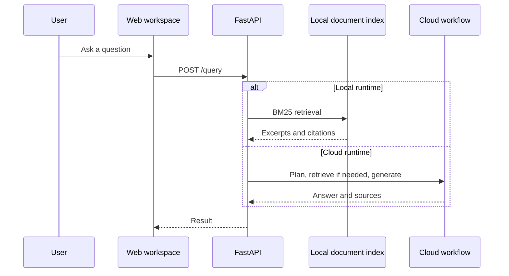

# System overview

FastAPI serves the web workspace and API in one process. The default local runtime searches saved document text using BM25 and returns cited excerpts. It requires no model or provider credentials.

The optional cloud runtime uses LangGraph for query planning, retrieval, response generation, and conversation memory. Parsing runs locally; embeddings, Qdrant search, and model calls use the configured services. FlashRank reranks retrieved passages on the local CPU.

## Request flow

The browser sends questions to `/query`. In local mode, the engine searches the selected document scope and returns evidence, or a no-evidence response when it cannot find a match.

Cloud mode distinguishes conversational requests from technical queries. The planner can send greetings or conversation-history questions directly to the responder. Technical queries retrieve documentation before generation.

## Project layout

- **`rag/`**: API, runtime selection, retrieval, ingestion, and cloud workflow.
- **`ui/web/`**: Integrated web workspace. The Streamlit scripts in `ui/` are optional clients.
- **`data/`**: Original source documents.
- **`processed_documents/`**: Saved extracted text searched by the local runtime.
- **`docs/`**: Technical guides.
- **[`README.md`](../README.md)**: Setup and execution commands.

Related guides: [ingestion](document_ingestion.md), [cloud nodes](rag_agent_nodes.md), [observability](observability.md), and [configuration](environment_variables.md).
