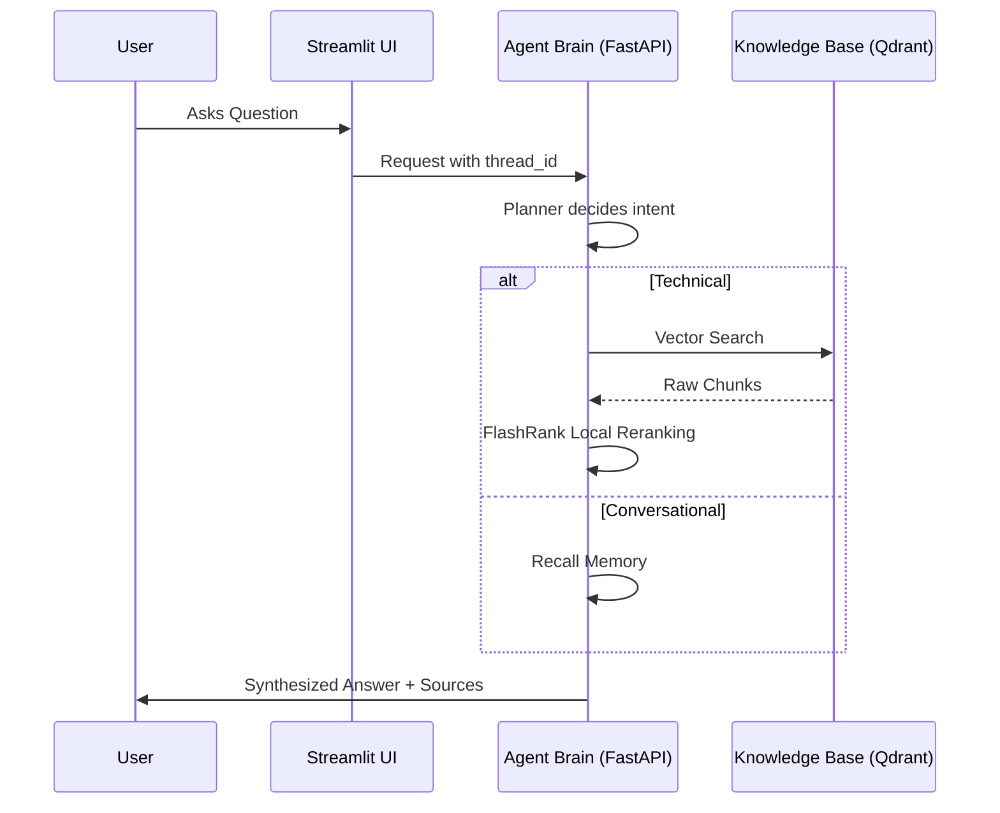

# 🤖 RAG: System Overview

A RAG application using **LangGraph** for query planning, retrieval, response generation, and conversation memory. Documents are parsed locally; model calls, embeddings, and vector search use configured services.

---

## 🌟 Vision
Most RAG systems fail because they treat every query the same. Our **Agentic RAG** distinguishes between:
1.  **Conversational Queries**: "Hi", "Who are you?", "What did I just say?"
2.  **Technical Queries**: "How do I configure Intel SRIOV on Kubernetes?"

By using a **Planner-Retriever-Responder** architecture, technical queries retrieve documentation before generation while conversational interactions remain fluid and fast.

---

## 🏗️ High-Level Flow

---

## 📂 Project Organization
*   **`rag/`**: The core Python package containing the Agent, Pipelines, and Services.
*   **`ui/`**: A premium Streamlit interface designed for source transparency.
*   **`data/`**: The ground-truth documentation used for ingestion.
*   **`docs/`**: This documentation suite.
*   **[`README.md`](../README.md)**: Setup and execution commands.

---

## 🚀 Quick Navigation
1.  **Ingestion**: [document_ingestion.md](document_ingestion.md)
2.  **Intelligence**: [rag_agent_nodes.md](rag_agent_nodes.md)
3.  **Observability**: [observability.md](observability.md)
4.  **Environment Variables**: [environment_variables.md](environment_variables.md)
